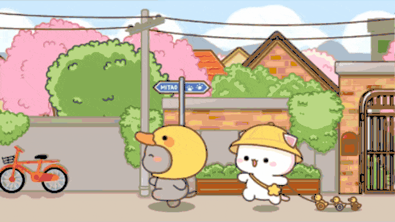

<p align="center">
  
</p>

<h1 align="center">🍑 Peachy</h1>

<p align="center">
  A friendly, all-in-one Discord bot for your community: moderation, economy, games, levels and more,
  all set up from a web dashboard.
</p>

<p align="center">
  <a href="https://peachygang.app"></a>
  <a href="https://discord.gg/peachygang"></a>
  
</p>

---

## ✨ What Peachy does

| | |
| --- | --- |
| 🛡️ **Moderation & safety** | Automod, verification (CAPTCHA or button), activity logs and staff tools |
| 💰 **Economy** | Coins, bank, shop, inventory, daily quests, buildings and a resource market |
| 🎲 **Games** | Blackjack, Baccarat, Khla Khlouk and other mini-games |
| 📈 **Levels** | Text and voice XP, role rewards, leaderboards and custom rank cards |
| 🎉 **Community** | Giveaways, tickets, forms, suggestions, reaction roles, confessions and families |
| 🔊 **Voice** | Temporary voice channels and server-stat counters |
| 🔔 **Social alerts** | Notifications for YouTube, Twitch and TikTok |
| 🌏 **Nine languages** | English, ខ្មែរ (Khmer), Français, 日本語, 한국어, မြန်မာ, Filipino, Tiếng Việt and 中文 |

Everything is configured from the dashboard at **[peachygang.app](https://peachygang.app)**. No commands needed to set it up.

## 🧩 Projects

| Repository | What it is | Built with |
| --- | --- | --- |
| **core** | The Discord bot: slash and prefix commands, events and background jobs | JavaScript · Bun · discord.js v14 · MongoDB |
| **website** | The site and server dashboard at peachygang.app | TypeScript · React 19 · Vite · Tailwind CSS |
| **api** | The backend behind the dashboard: Discord login, server settings, payments | TypeScript · NestJS · MongoDB |

```
Discord ◀──▶ core (bot) ──▶ MongoDB ◀── api (NestJS) ◀── website (peachygang.app)
```

## 💬 Get in touch

- **Add Peachy to your server:** [peachygang.app](https://peachygang.app)
- **Need help or found a bug?** Join the [support server](https://discord.gg/peachygang)

<p align="center"><sub>Made with 🍑 in Cambodia by the Peachy team</sub></p>
